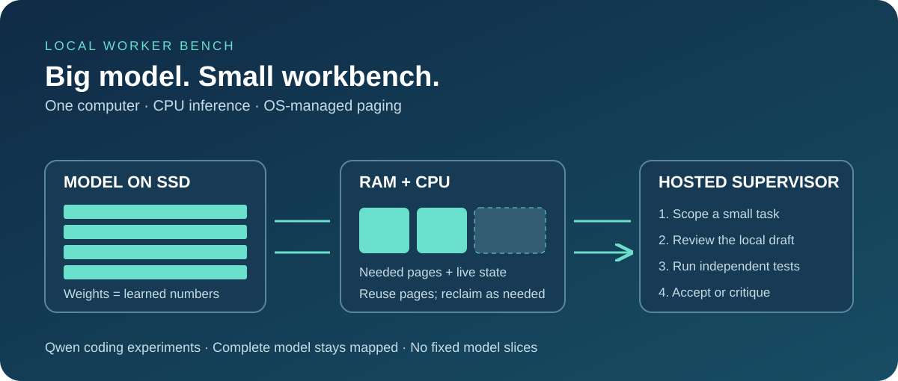

# Local Worker Bench

<p align="center">
  
</p>

<p align="center">
  <a href="https://github.com/bbartling/local-worker-bench/actions/workflows/tests.yml"></a>
</p>

A supervised local coding worker for models larger than RAM. One computer,
CPU inference, model weights on SSD, and the operating system managing which
pages stay in memory. The hosted agent plans, reviews, tests and accepts every patch.

- Windows: measured Qwen3-Coder-Next **80B Q4** inference on an i7-9700 / 32 GB PC.
- Automatic admission budget: up to **66% of available RAM**, with a desktop reserve.
- Local Ollama-shaped API over **llama.cpp**; bounded requests and worker cleanup.
- Durable draft/review checkpoints, explicit prompt packets and independent grading.
- Linux planning is available; Linux/WSL inference qualification is a separate phase.

## Start

```powershell
python -m local_worker_bench selftest
python -m local_worker_bench paging-plan --manifest results/model-cache/qwen3-coder-next-q4/verified-manifest.json --backend results/layer-stream-backend/build/bin/Release/llama-server.exe --output results/paging.json
python -m local_worker_bench serve-offload --config results/paging.json --port 11438
```

The API starts idle. Models/backend must already exist; these commands do not
download them. Inference requires an explicit request. Paging is not dividing
the model into independent mini-models, and a RAM budget is not a fit guarantee.

## Read

| Guide | Purpose |
| --- | --- |
| [Setup and API](docs/guide.md) | Paging, hardware budgets, models, Windows/Linux and Ollama |
| [Agent instructions](docs/agent-guide.md) | Small coding tasks, prompt template, review checkpoints |
| [Evaluation](docs/evaluation.md) | Actual grades, timings, precision and prompt comparisons |
| [Illustrated guide](docs/reports/os-paging-guide.pdf) | High-level PDF, at most ten pages |

Offline CI never downloads models or executes generated candidates.
Earlier cluster/LAN experiments are retained only as [research context](research/README.md).
